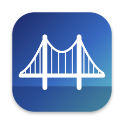

<p align="center">
  
</p>

<h1 align="center">Ko'prik</h1>

<p align="center">
  A free, open-source alternative to CrossOver for running Windows games and apps on Apple silicon Macs.
</p>

---

Ko'prik ("bridge" in Uzbek) is a native SwiftUI app that runs Windows programs through [Wine](https://www.winehq.org). It does what CrossOver does for most people (bottles, a game library, Steam and other stores, graphics translation to Metal), adds per-program settings and snapshots, and costs nothing.

It is not affiliated with CodeWeavers. It contains no CrossOver code: the engine is Wine with CrossOver's own LGPL-licensed patches, as built by the open-source [winecx-gptk](https://github.com/frankea/winecx-gptk) project, and downloaded on first run.

## What it does

- **Bottles.** Separate Windows environments, each with its own C: drive and registry. A new bottle takes under a second (cloned from a ready-made prefix on APFS). Duplicate, rename, move to the Trash, snapshot and roll back.
- **Library.** Programs are found automatically from Start Menu shortcuts and Steam's manifests, with real icons from the `.exe` and Steam cover art. Favourites, recently played and play time.
- **Per-program settings.** Graphics backend, sync mode, HUDs, AVX, ray tracing, environment variables, DLL overrides and arguments can be set for each program, not just each bottle. Settings stack: engine defaults, then the bottle, then the program, then a one-off "Play With".
- **Sign-in links come back.** Links that Windows programs register (`notion://`, `zoommtg://`, ...) are taken over on the Mac side and handed to the program in its bottle, so "Continue in browser" sign-ins work.
- **Graphics.** DXMT (Direct3D 10/11 to Metal), DXVK (Direct3D to Vulkan over MoltenVK), wined3d, and Apple's D3DMetal once you import the Game Porting Toolkit. "Auto" reads the program's import table to pick one and shows why.
- **Smooth, low-latency games.** Wine runs inside an app bundle that macOS recognises as a game, so Game Mode turns on in full screen, and full-screen games get the display to themselves instead of going through the compositor. On an M2 Pro, Brawlhalla went from 30-55 to 90-115 FPS in a four-player match, with less input lag. Per-program frame rate caps and MetalFX upscaling (DXMT) are one click away.
- **Steam that works.** Steam's interface is drawn on DXVK, the only backend it renders correctly with. Games are started directly with their own backend placed in the game folder, so a game can use DXMT while Steam keeps running. The Steam overlay, which crashes under Wine and takes the client down with it, is switched off.
- **Untrusted programs can't touch your Mac.** Wine itself is not a sandbox: a Windows program can read and change your files (tested: a plain `cmd` command wrote to the Mac desktop). Ko'prik runs any `.exe` you open from outside Steam and the stores in an isolated bottle, inside macOS's own kernel sandbox: no access to your home folder, no Mac programs can be started, no Apple Events to other apps, and optionally no internet. The Windows program cannot switch it off. The same write attempt is refused with "Access denied".
- **Any Windows program.** Drop an `.exe`, `.msi` or installer on the window. Electron apps (Notion, Discord, Slack, ...) install and run: Ko'prik works around Wine's PowerShell stub that makes their installers stop with "app is running", and draws them on DXVK, where they render. Tested with Notion and Zoom.
- **Epic Games and GOG without their launchers.** Sign in, browse your library, install into a bottle and play, through [legendary](https://github.com/derrod/legendary) and [heroic-gogdl](https://github.com/Heroic-Games-Launcher/heroic-gogdl).
- **Installing software.** Unattended recipes for Steam, Epic Games Launcher, GOG Galaxy, Battle.net, EA app, Ubisoft Connect, Rockstar and 7-Zip; a winetricks picker for runtimes and fonts. A snapshot is taken first, so an install that goes wrong can be undone.
- **Compatibility.** ProtonDB ratings and anti-cheat status from [AreWeAntiCheatYet](https://areweanticheatyet.com) are shown before you spend an hour downloading a game that cannot run.
- **Diagnostics.** A log analyser recognises common failures (missing runtimes, .NET, DirectX 12 without D3DMetal, AVX, anti-cheat) and offers the fix.
- **macOS integration.** One window, a menu bar item, `.app` launchers for the Dock and Spotlight, Shortcuts and Siri actions ("Play … in Ko'prik"), `koprik://` links, Quick Look icons for `.exe` files in Finder, a controller tester, save-game backups, import from Whisky, English, Uzbek and Russian.
- **Updates.** The app updates itself with Sparkle; engines and components update separately and never touch a bottle that works.
- **Command line.** Everything the app does is available from `koprik`.

## How it compares with CrossOver

| | CrossOver | Ko'prik |
|---|---|---|
| Price | 54 USD a year, or 494 USD for life | Free |
| Source | Closed app, open Wine patches | Open, MIT |
| Engines | One, bundled | Several side by side; each bottle keeps its own |
| Graphics backend | Per bottle | Per program |
| Snapshots and rollback | No | Yes, automatic before installs |
| Steam games with their own backend | No | Yes |
| Epic and GOG games without their launchers | No | Yes |
| Frame rate cap and MetalFX upscaling per program | No | Yes |
| Shortcuts, Quick Look, controller tester, save backups | No | Yes |
| Untrusted programs sandboxed away from your files | No | Yes, by default |
| Anti-cheat warning before download | No | Yes |
| Install recipes | Thousands, tested by staff | A handful, plus winetricks |
| Support | Paid staff | None |

Building the engine yourself: `scripts/build-engine.sh` builds Wine with CrossOver's patches from source and packages it in the layout Ko'prik installs; `.github/workflows/build-engine.yml` runs it on GitHub's Apple silicon runners and publishes `engine-v*` releases, which `koprik engine install koprik` installs.

Ko'prik cannot do what no Wine-based tool can: games with kernel-level anti-cheat (Valorant, Fortnite, Call of Duty and others) do not run.

## Requirements

- A Mac with Apple silicon.
- macOS 26 or later.
- Rosetta 2 (`softwareupdate --install-rosetta --agree-to-license`). Every public Wine build for macOS is an Intel build; Apple has said Rosetta stays available through macOS 27.
- About 1.5 GB of disk space for the engine.

## Installing

From a release: download the `.dmg` from [Releases](https://github.com/Xazratbek/koprik/releases), drag Ko'prik to Applications, then right-click it and choose Open the first time (the app is not notarised).

From source (needs Xcode 26 and [XcodeGen](https://github.com/yonaskolb/XcodeGen)):

```sh
brew install xcodegen
git clone https://github.com/Xazratbek/koprik.git
cd koprik
scripts/install.sh        # builds a Release copy into /Applications
```

On first launch Ko'prik checks for Rosetta and downloads the Wine engine (about 480 MB, verified by SHA-256).

## DirectX 12 games

DirectX 12 needs Apple's D3DMetal from the [Game Porting Toolkit](https://developer.apple.com/games/game-porting-toolkit/). Apple does not allow it to be redistributed, so download the disk image yourself with a free Apple developer account, then choose it in Settings > Graphics > Import. Ko'prik only accepts files signed by Apple.

## Command line

The `koprik` tool lives in `KoprikKit`:

```sh
cd KoprikKit && swift build -c release
.build/release/koprik doctor
.build/release/koprik engine install gaming
.build/release/koprik bottle create Games
.build/release/koprik run Games ~/Downloads/SteamSetup.exe -- /S
.build/release/koprik programs Games
.build/release/koprik run Games "Brawlhalla" --metal-hud
.build/release/koprik stop Games "Brawlhalla"
```

Run `koprik --help` for the rest: snapshots, backends, environment, process list.

## Project layout

| Path | What it is |
|---|---|
| `KoprikKit/` | Swift package with all the logic (engines, bottles, launching, graphics, library, recipes, compatibility, diagnostics) and the `koprik` command-line tool. No UI. |
| `Koprik/` | The SwiftUI app, a thin layer over KoprikKit. |
| `project.yml` | XcodeGen spec; the Xcode project is generated from it. |
| `scripts/` | Install, release, icon and translation scripts. |
| `docs/` | Plan, component research, test log with measurements and the bugs found. Mostly in Uzbek. |

Run the tests with `cd KoprikKit && swift test`.

## Status

Ko'prik is young and was built for one person's Mac first. Tested so far on an M2 Pro with macOS 27: Notepad, silent 7-Zip install, the Steam client (sign-in, store, library, downloads), Brawlhalla on DXMT, DXVK and wined3d with Game Mode on, Notion and Zoom. See [docs/SINOV.md](docs/SINOV.md) for results and measurements. DirectX 12 through D3DMetal (Game Porting Toolkit 4.0 beta 3) was tested with a small Direct3D 12 program in `scripts/dx12-test`: feature level 12_2, a steady 120 FPS on a 120 Hz display.

## Credits and licences

Ko'prik is MIT-licensed. It downloads and runs, but does not include:

- [Wine](https://www.winehq.org) (LGPL), with CrossOver's open-source patches, built by [frankea/winecx-gptk](https://github.com/frankea/winecx-gptk)
- [DXMT](https://github.com/3Shain/dxmt), [DXVK-macOS](https://github.com/Gcenx/DXVK-macOS), [MoltenVK](https://github.com/KhronosGroup/MoltenVK)
- [winetricks](https://github.com/Winetricks/winetricks) (LGPL)

It uses [Sparkle](https://sparkle-project.org) (MIT) for updates and [swift-argument-parser](https://github.com/apple/swift-argument-parser) (Apache 2.0). Compatibility data comes from [AreWeAntiCheatYet](https://github.com/AreWeAntiCheatYet/AreWeAntiCheatYet) (MIT) and [ProtonDB](https://www.protondb.com).

CrossOver is a trademark of CodeWeavers, Inc. Windows, DirectX and Direct3D are trademarks of Microsoft. Steam is a trademark of Valve.
